# LoL Builds

Saityno taikomųjų programų projektavimo modulio projektas – „League of Legends“ čempionų build’ų kūrimo ir aptarimo platforma.

- **Kliento aplikacija:** https://lol-builds.up.railway.app
- **REST API:** https://api-production-3b89593d.up.railway.app/api/v1/champions
- **Swagger UI:** https://api-production-3b89593d.up.railway.app/swagger
- **OpenAPI specifikacija:** [`api-spec.yaml`](api-spec.yaml)

Demonstraciniai naudotojai (slaptažodis `Password123!`): `admin` (Admin), `faker_fan`, `jungle_diff`, `support_main`, `top_gap_tom`, `adc_andy`, `ward_warden`, `mid_or_feed` (User).

## Turinys

1. [Sprendžiamo uždavinio aprašymas](#1-sprendžiamo-uždavinio-aprašymas)
2. [Sistemos architektūra](#2-sistemos-architektūra)
3. [Naudotojo sąsajos projektas](#3-naudotojo-sąsajos-projektas)
4. [API specifikacija](#4-api-specifikacija)
5. [Paleidimas](#5-paleidimas)
6. [Išvados](#6-išvados)

## 1. Sprendžiamo uždavinio aprašymas

### 1.1. Sistemos paskirtis

„League of Legends“ žaidėjai tam pačiam čempionui gali naudoti skirtingus item’us, summoner spell’us ir runas, priklausomai nuo žaidimo pozicijos bei pasirinktos strategijos. Norint pasidalinti tokiu pasirinkimu, reikia pateikti ne tik patį build’ą, bet ir paaiškinti, kada ir kaip jį naudoti.

Projekto tikslas – sukurti internetinę platformą, kurioje naudotojai galėtų kurti čempionams skirtus build’us, dalintis jais ir aptarti juos komentaruose. Build’ą sudaro pavadinimas, aprašymas, žaidimo pozicija, pasirinkti item’ai, summoner spell’ai ir runos.

Čempionai iš anksto įkelti į sistemą, o jų informaciją valdo administratorius. Build’us ir komentarus kuria registruoti naudotojai. Neprisijungę lankytojai gali peržiūrėti viešai pateiktą turinį.

### 1.2. Taikomosios srities objektai

Sistemoje yra trys pagrindiniai objektai:

| Objektas | Paskirtis ir pagrindinė informacija |
| --- | --- |
| **Čempionas (Champion)** | Žaidimo čempionas, kuriam kuriami build’ai. Saugomas jo pavadinimas, titulas, aprašymas ir paveikslėlio nuoroda. |
| **Build’as (Build)** | Konkrečiam čempionui skirtas naudotojo sukurtas build’as. Saugomas pavadinimas, aprašymas, žaidimo pozicija, pasirinkti item’ai, summoner spell’ai, runos, autorius ir sukūrimo bei atnaujinimo laikas. |
| **Komentaras (Comment)** | Naudotojo atsiliepimas arba klausimas po konkrečiu build’u. Saugomas tekstas, autorius ir sukūrimo bei atnaujinimo laikas. |

Objektai sudaro hierarchiją **Champion → Build → Comment**:

- Vienam čempionui gali priklausyti daug build’ų. Kiekvienas build’as priklauso vienam čempionui.
- Vienam build’ui gali priklausyti daug komentarų. Kiekvienas komentaras priklauso vienam build’ui.

Naudotojų paskyros saugomos atskirai ir naudojamos autentifikacijai, autorizacijai bei turinio autorystei nustatyti. Jos nėra vienas iš trijų pagrindinių taikomosios srities objektų.

Item’ai, summoner spell’ai ir runos pasirenkami iš iš anksto parengto katalogo. Pasirinkta kombinacija saugoma kaip build’o dalis; atskiros jų CRUD valdymo funkcijos į pradinę projekto apimtį neįtraukiamos.

### 1.3. Funkciniai reikalavimai

#### Svečias

Neprisijungęs naudotojas gali:

1. Peržiūrėti čempionų sąrašą ir konkretaus čempiono informaciją.
2. Peržiūrėti pasirinktam čempionui sukurtus build’us.
3. Peržiūrėti konkretaus build’o aprašymą, item’us, summoner spell’us ir runas.
4. Peržiūrėti build’o komentarus.
5. Užsiregistruoti ir prisijungti prie sistemos.

#### Registruotas naudotojas

Prisijungęs naudotojas gali naudotis svečiui prieinamomis turinio peržiūros funkcijomis ir papildomai:

1. Sukurti pasirinktam čempionui skirtą build’ą: nurodyti jo pavadinimą, aprašymą ir žaidimo poziciją, pasirinkti item’us, summoner spell’us bei runas.
2. Redaguoti ir pašalinti savo sukurtus build’us.
3. Rašyti komentarus po build’ais.
4. Redaguoti ir pašalinti savo komentarus.
5. Atsijungti nuo sistemos.

Registruotas naudotojas negali redaguoti ar pašalinti kitų naudotojų build’ų ir komentarų. Šios teisės tikrinamos serverio pusėje pagal prisijungusio naudotojo identifikatorių.

#### Administratorius

Administratorius gali naudotis registruotam naudotojui prieinamomis funkcijomis ir papildomai:

1. Pridėti naują čempioną.
2. Redaguoti čempiono informaciją.
3. Pašalinti čempioną.
4. Pašalinti netinkamus build’us ir komentarus, nepriklausomai nuo jų autoriaus.

## 2. Sistemos architektūra

### 2.1. Diegimo diagrama

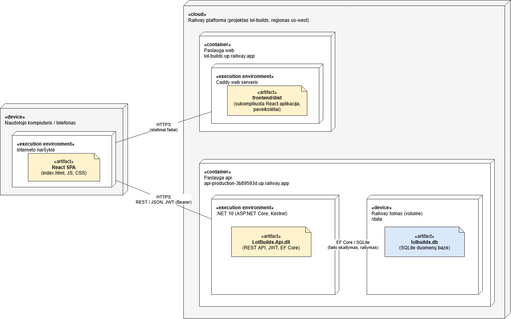

Diagramos šaltinis: [`docs/deployment-diagram.drawio`](docs/deployment-diagram.drawio) (draw.io).

Sistemą sudaro trys dalys:

1. **Kliento aplikacija** – React ir TypeScript grafinė sąsaja, vykdoma naudotojo naršyklėje. Jos failus aptarnauja Railway paslauga `web` (Caddy serveris).
2. **REST API** – ASP.NET Core serverio aplikacija (Railway paslauga `api`), vykdanti užklausas, tikrinanti teises ir dirbanti su duomenų baze.
3. **Duomenų bazė** – SQLite failas Railway tome (volume), prijungtame prie `api` paslaugos. Joje saugomi čempionai, build’ai, komentarai, naudotojų paskyros ir atnaujinimo žetonai.

Naršyklė gauna kliento aplikacijos failus iš `web` paslaugos, o aplikacija kreipiasi į REST API per HTTPS, perduodama JWT žetoną `Authorization` antraštėje. Prie duomenų bazės jungiasi tik serverio aplikacija; naršyklė tiesioginės prieigos prie jos neturi. Abi paslaugos diegiamos automatiškai iš `main` šakos.

| Dalis | Adresas | Vykdymo aplinka |
| --- | --- | --- |
| Kliento aplikacija | https://lol-builds.up.railway.app | Railway paslauga `web`: sukompiliuoti React failai, aptarnaujami Caddy serverio |
| REST API | https://api-production-3b89593d.up.railway.app | Railway paslauga `api`: ASP.NET Core (.NET 10, Kestrel) |
| API dokumentacija | https://api-production-3b89593d.up.railway.app/swagger | Swagger UI |
| Duomenų bazė | – | SQLite failas `/data/lolbuilds.db` Railway tome (volume), prijungtame prie `api` paslaugos |

Produkcinėje aplinkoje konfigūracija perduodama aplinkos kintamaisiais: `Jwt__Key` (žetonų pasirašymo raktas), `ConnectionStrings__Default` (duomenų bazės kelias), `Cors__AllowedOrigins` (leidžiamas kliento aplikacijos adresas) ir `VITE_API_URL` (API adresas kliento aplikacijai).

Produkcinėje aplinkoje konfigūracija perduodama aplinkos kintamaisiais: `Jwt__Key` (žetonų pasirašymo raktas), `ConnectionStrings__Default` (duomenų bazės kelias), `Cors__AllowedOrigins` (leidžiamas kliento aplikacijos adresas) ir `VITE_API_URL` (API adresas kliento aplikacijai).

### 2.2. Pasirinktos technologijos

| Sistemos dalis | Technologija | Pasirinkimo pagrindimas |
| --- | --- | --- |
| Kliento dalis | **React ir TypeScript** | React komponentai leidžia kurti ir pakartotinai naudoti čempionų, build’ų bei komentarų sąsajos elementus. TypeScript padeda aprašyti API duomenų struktūras ir aptikti tipų klaidas kuriant programą. |
| Serverio dalis | **C# ir ASP.NET Core** | Naudojami REST API, duomenų tikrinimui, autentifikacijai ir autorizacijai realizuoti. Šios technologijos jau naudojamos kituose projektuose. |
| Duomenų bazė | **SQLite** | Reliacinė duomenų bazė, laikoma viename faile ir nereikalaujanti atskiro serverio. Užtenka šios sistemos apkrovai, palaiko išorinius raktus ir kaskadinį trynimą. Esant daug lygiagrečių rašymų, tinkamesnė būtų PostgreSQL. |
| Prieiga prie duomenų bazės | **Entity Framework Core** | Duomenų modelis aprašomas C# klasėmis. Paleidus programą, duomenų bazė sukuriama ir užpildoma pradiniais duomenimis automatiškai. |

### 2.3. Autentifikacija ir autorizacija

Naudojami JWT prieigos žetonai ir atnaujinimo (refresh) žetonai.

| Metodas | Kelias | Paskirtis |
| --- | --- | --- |
| POST | `/api/v1/auth/register` | Registracija (rolė `User`). Grąžina žetonų porą. |
| POST | `/api/v1/auth/login` | Prisijungimas. Grąžina žetonų porą. |
| POST | `/api/v1/auth/refresh` | Atnaujinimo žetono keitimas nauja žetonų pora. |
| POST | `/api/v1/auth/logout` | Atsijungimas: panaikinami visi naudotojo atnaujinimo žetonai. |
| GET | `/api/v1/auth/me` | Prisijungusio naudotojo duomenys. |

- **Prieigos žetonas** – JWT, galioja 15 min., siunčiamas antraštėje `Authorization: Bearer <žetonas>`. Jame saugomi naudotojo ID (`sub`), vardas (`unique_name`), rolė (`role`), unikalus ID (`jti`), galiojimo laikas (`exp`), išdavėjas (`iss`) ir auditorija (`aud`). Pasirašomas HMAC-SHA256 algoritmu slaptu raktu `Jwt:Key`, kuris produkcinėje aplinkoje nustatomas aplinkos kintamuoju `Jwt__Key`.
- **Atnaujinimo žetonas** – atsitiktinė 64 baitų eilutė, galioja 7 d. Duomenų bazėje saugoma tik jo SHA-256 maiša. Kiekvieną kartą atnaujinant senas žetonas panaikinamas ir išduodamas naujas (rotacija). Jei panaudotas žetonas pateikiamas dar kartą, panaikinami visi to naudotojo žetonai.
- **Rolės** – svečias (be žetono), `User` ir `Admin`. Čempionus kurti, redaguoti ir šalinti gali tik `Admin`. Build’us ir komentarus kuria prisijungę naudotojai; redaguoti gali tik autorius, šalinti – autorius arba administratorius. Autorystė tikrinama serverio pusėje pagal žetone esantį naudotojo ID.
- **Atsako kodai** – `401`, kai žetono nėra, jis netinkamas ar pasibaigęs; `403`, kai naudotojas prisijungęs, bet neturi teisių.

## 3. Naudotojo sąsajos projektas

Kiekvienam pagrindiniam langui pateiktas projektuotas wireframe’as ir jį atitinkanti realizacijos iškarpa.

### 3.1. Čempionų sąrašas

| Wireframe | Realizacija |
| --- | --- |
| 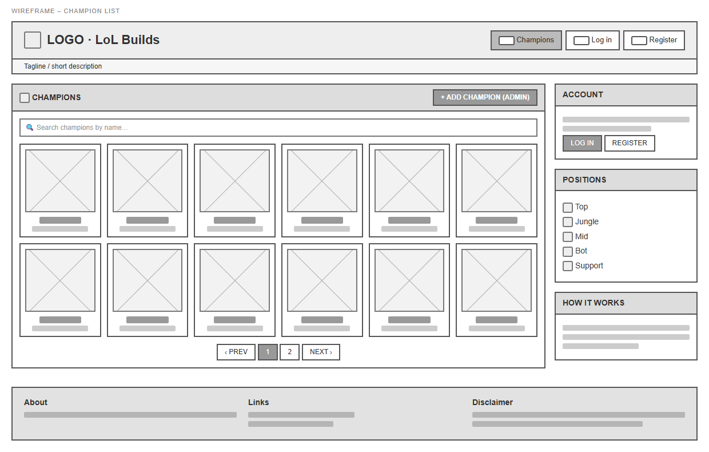 | 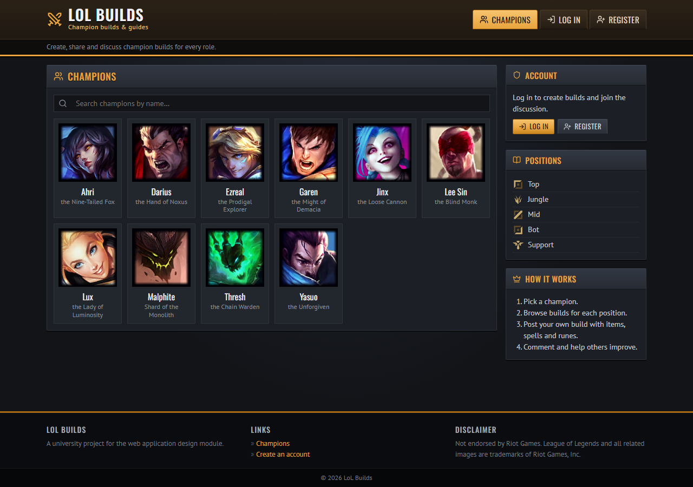 |

### 3.2. Čempiono puslapis su build’ų sąrašu

| Wireframe | Realizacija |
| --- | --- |
| 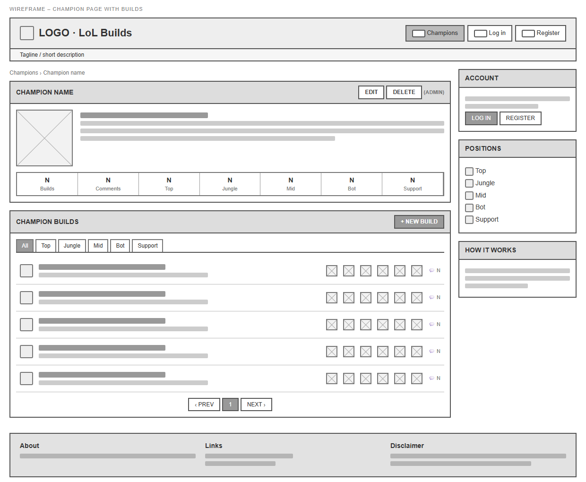 | 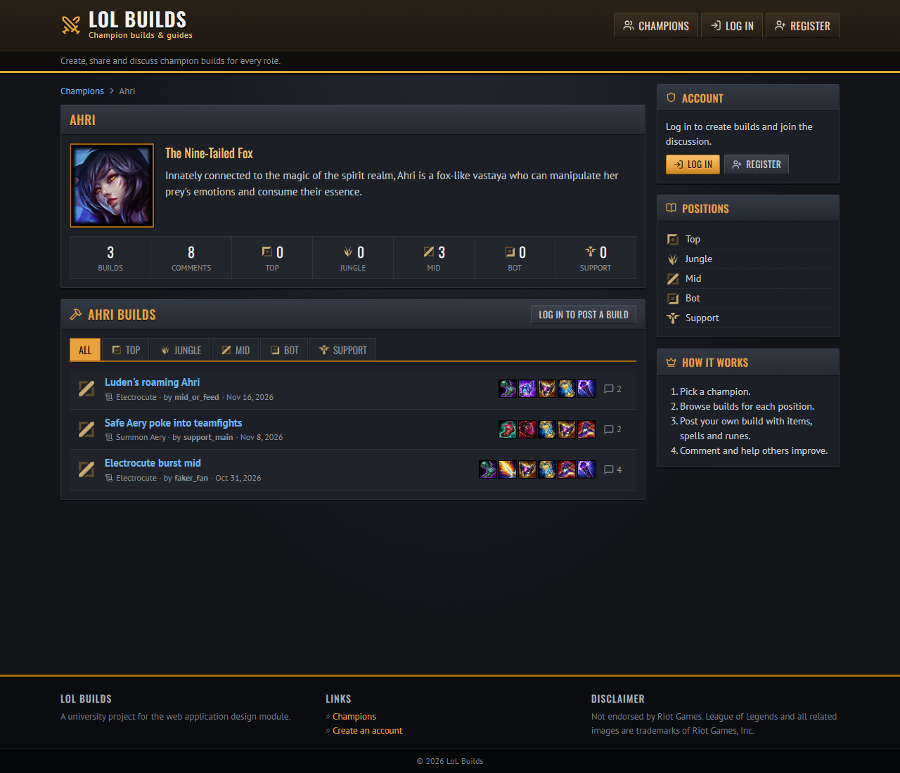 |

### 3.3. Build’o puslapis su komentarais

| Wireframe | Realizacija |
| --- | --- |
| 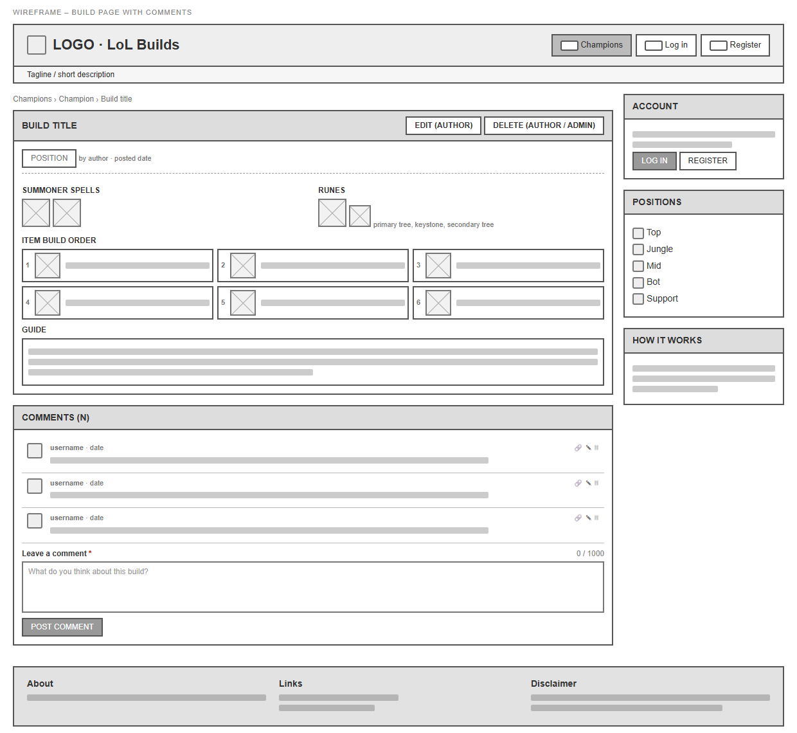 | 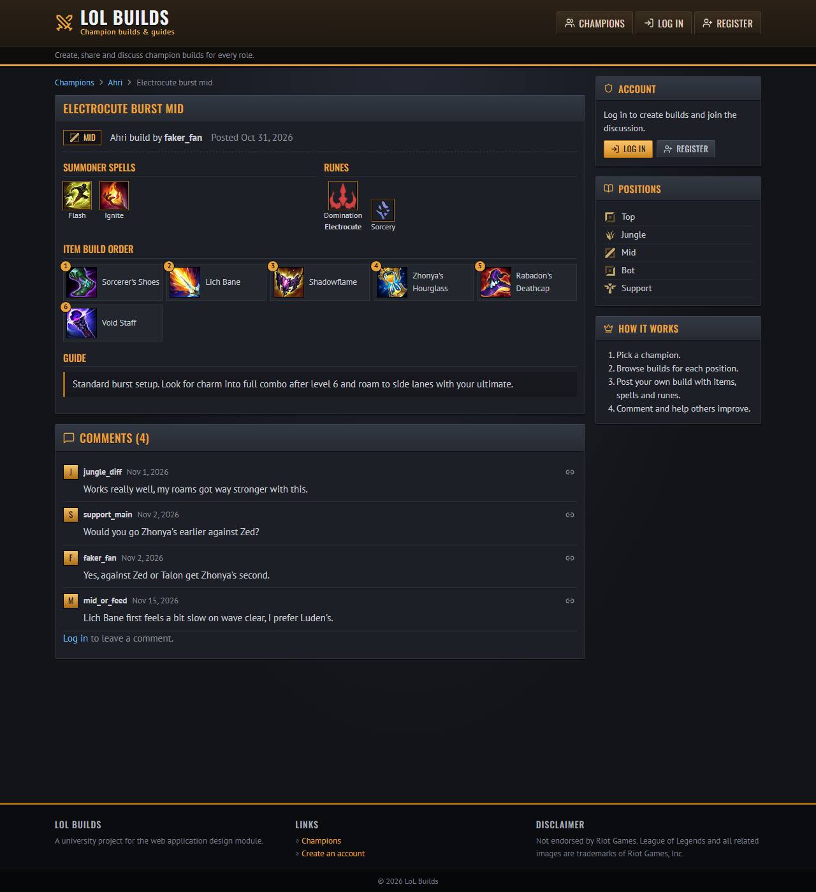 |

### 3.4. Prisijungimas ir registracija

| Wireframe | Realizacija |
| --- | --- |
| 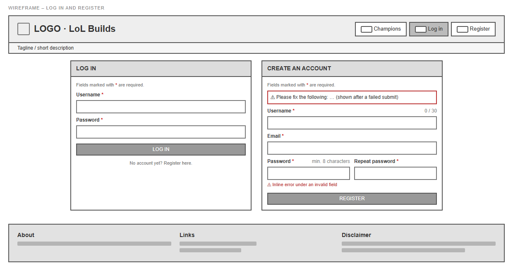 | 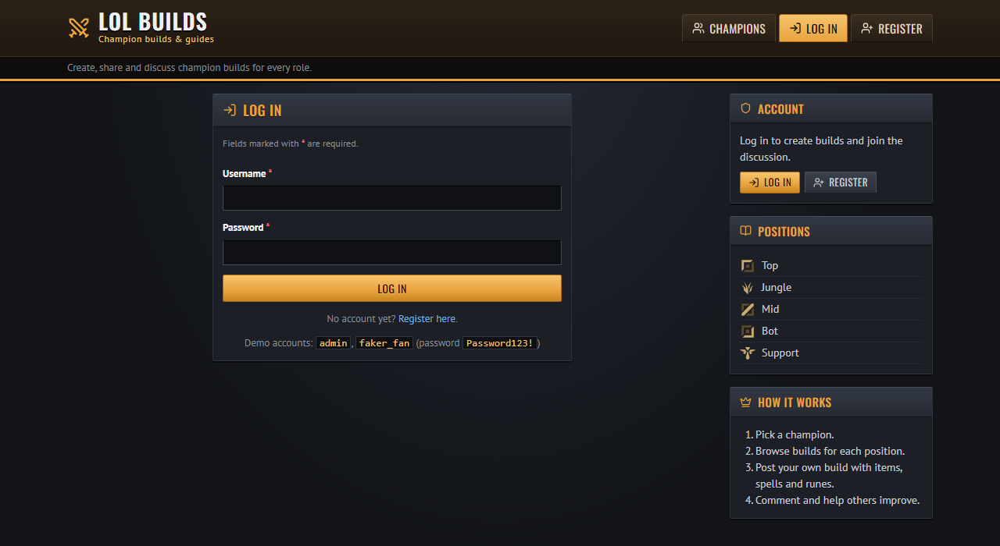 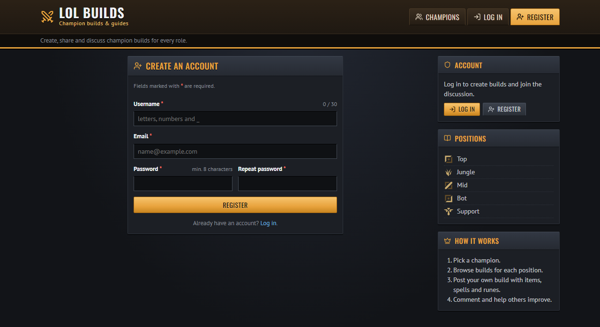 |

### 3.5. Mobilus vaizdas

Iki 768 px pločio šoninė juosta perkeliama po turiniu, o meniu pakeičiamas „hamburger“ mygtuku.

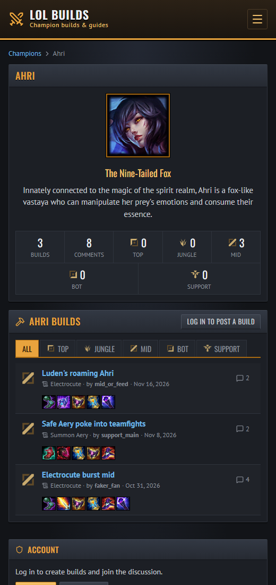

Kiti sąsajos sprendimai: kūrimo, redagavimo ir trynimo formos atidaromos modaliniuose languose; formose naudojami teksto, teksto srities, išskleidžiamojo sąrašo, žymimųjų langelių, akučių ir failo įkėlimo laukai; privalomi laukai pažymėti `*`, klaidos rodomos prie laukų; apie veiksmų rezultatus pranešama iškylančiais pranešimais (be naršyklės `alert`); naudojami Oswald ir PT Sans šriftai bei SVG ikonos (Lucide).

## 4. API specifikacija

Struktūrinis API aprašas OpenAPI 3 formatu pateiktas faile [`api-spec.yaml`](api-spec.yaml). Ta pati specifikacija interaktyviai pasiekiama per [Swagger UI](https://api-production-3b89593d.up.railway.app/swagger).

### 4.1. Bendra informacija

- **Bazinis adresas:** `https://api-production-3b89593d.up.railway.app` (lokaliai `http://localhost:5224`). Visi keliai prasideda `/api/v1/`.
- **Formatas:** užklausos ir atsakymai JSON (`application/json`), klaidos – `application/problem+json` (RFC 7807).
- **Autentifikacija:** `Authorization: Bearer <access_token>` antraštė; žetonas gaunamas per `POST /api/v1/auth/login`.

| Objektas | Metodas | Kelias | Paskirtis |
| --- | --- | --- | --- |
| Champion | GET | `/api/v1/champions` | Gauti čempionų sąrašą. |
| Champion | POST | `/api/v1/champions` | Sukurti čempioną. |
| Champion | GET | `/api/v1/champions/{championId}` | Gauti konkretų čempioną. |
| Champion | PUT | `/api/v1/champions/{championId}` | Atnaujinti čempioną. |
| Champion | DELETE | `/api/v1/champions/{championId}` | Pašalinti čempioną. |
| Build | GET | `/api/v1/champions/{championId}/builds` | Gauti konkretaus čempiono build’ų sąrašą. |
| Build | POST | `/api/v1/champions/{championId}/builds` | Sukurti build’ą konkrečiam čempionui. |
| Build | GET | `/api/v1/champions/{championId}/builds/{buildId}` | Gauti konkretų čempiono build’ą. |
| Build | PUT | `/api/v1/champions/{championId}/builds/{buildId}` | Atnaujinti build’ą. |
| Build | DELETE | `/api/v1/champions/{championId}/builds/{buildId}` | Pašalinti build’ą. |
| Comment | GET | `/api/v1/champions/{championId}/builds/{buildId}/comments` | Gauti konkretaus build’o komentarų sąrašą. |
| Comment | POST | `/api/v1/champions/{championId}/builds/{buildId}/comments` | Sukurti komentarą po konkrečiu build’u. |
| Comment | GET | `/api/v1/champions/{championId}/builds/{buildId}/comments/{commentId}` | Gauti konkretų build’o komentarą. |
| Comment | PUT | `/api/v1/champions/{championId}/builds/{buildId}/comments/{commentId}` | Atnaujinti komentarą. |
| Comment | DELETE | `/api/v1/champions/{championId}/builds/{buildId}/comments/{commentId}` | Pašalinti komentarą. |

Komentarų keliai apima visus tris hierarchijos objektus. Serveris tikrina, ar build’as priklauso nurodytam čempionui, o komentaras – nurodytam build’ui; jei ne, grąžinama `404`.

Papildomai:

- **Puslapiavimas** – visi sąrašų metodai priima `page` ir `pageSize` (1–50) parametrus ir grąžina `items`, `page`, `pageSize`, `totalCount`, `totalPages`.
- **Filtravimas** – čempionai pagal pavadinimą (`?name=ah`), build’ai pagal poziciją (`?position=Mid`), komentarai pagal tekstą (`?search=zhonya`).
- **Hypermedia** – kiekvienas objektas ir sąrašas turi `links` masyvą su susijusiais keliais ir leidžiamais veiksmais (`self`, `update`, `delete`, `builds`, `comments`, `next`, `previous` ir kt.).
- **Suvestinė iš kelių esybių** – `GET /api/v1/champions/{championId}/summary` grąžina čempioną, jo build’ų ir komentarų skaičių, build’ų pasiskirstymą pagal pozicijas ir naujausius build’us.

Bendri atsako kodai:

| Kodas | Reikšmė |
| --- | --- |
| `200` | Sėkminga užklausa. |
| `201` | Objektas sukurtas; `Location` antraštė nurodo naujo objekto adresą. |
| `204` | Objektas ištrintas arba veiksmas atliktas, atsakymo turinio nėra. |
| `400` | Neperskaitomas JSON arba netinkami reikšmių tipai. |
| `401` | Naudotojas neprisijungęs arba žetonas netinkamas / pasibaigęs. |
| `403` | Naudotojas prisijungęs, bet neturi teisių (netinkama rolė arba ne autorius). |
| `404` | Objektas nerastas arba nepriklauso nurodytam tėviniam objektui. |
| `409` | Toks čempionas, naudotojo vardas ar el. paštas jau yra. |
| `422` | JSON teisingas, bet reikšmės neatitinka validacijos taisyklių. |

### 4.2. Metodų aprašai ir pavyzdžiai

Kiekvienam metodui nurodyti galimi atsako kodai ir realūs užklausų bei atsakymų pavyzdžiai (spauskite pavyzdį, kad jis išsiskleistų). Ilgi sąrašai ir žetonai pavyzdžiuose sutrumpinti (`…`).

#### Autentifikacija

##### `POST /api/v1/auth/login`

Log in with username and password. Returns an access token and a refresh token.  
**Reikia prisijungti:** Ne

| Atsako kodas | Reikšmė |
| --- | --- |
| `200` | Success. |
| `401` | Not logged in, or the token is missing, invalid or expired. |
| `422` | The JSON is valid, but the values break validation rules. |

<details><summary>Sėkmingas prisijungimas → <code>200</code></summary>

Užklausa:

```http
POST /api/v1/auth/login
Content-Type: application/json

{
  "username": "faker_fan",
  "password": "Password123!"
}
```

Atsakymas:

```http
HTTP/1.1 200

{
  "accessToken": "eyJhbGciOiJIUzI1NiIsInR5…",
  "accessTokenExpiresAt": "2026-11-20T03:41:14.9067298Z",
  "refreshToken": "wPxR/KUB9iTILpjz2vOY4+8V…",
  "refreshTokenExpiresAt": "2026-11-27T03:26:14.9047007Z",
  "user": {
    "id": 2,
    "username": "faker_fan",
    "email": "faker_fan@lolbuilds.dev",
    "role": "User"
  }
}
```

</details>

<details><summary>Neteisingas slaptažodis → <code>401</code></summary>

Užklausa:

```http
POST /api/v1/auth/login
Content-Type: application/json

{
  "username": "faker_fan",
  "password": "wrong"
}
```

Atsakymas:

```http
HTTP/1.1 401

{
  "type": "https://tools.ietf.org/html/rfc9110#section-15.5.2",
  "title": "Unauthorized",
  "status": 401,
  "detail": "Wrong username or password."
}
```

</details>

##### `POST /api/v1/auth/logout`

Log out: revokes all of the current user's refresh tokens.  
**Reikia prisijungti:** Taip

| Atsako kodas | Reikšmė |
| --- | --- |
| `204` | Done, no response body. |
| `401` | Not logged in, or the token is missing, invalid or expired. |

<details><summary>Atsijungimas → <code>204</code></summary>

Užklausa:

```http
POST /api/v1/auth/logout
Authorization: Bearer <access_token>
```

Atsakymas:

```http
HTTP/1.1 204
```

</details>

##### `GET /api/v1/auth/me`

Get the currently logged-in user.  
**Reikia prisijungti:** Taip

| Atsako kodas | Reikšmė |
| --- | --- |
| `200` | Success. |
| `401` | Not logged in, or the token is missing, invalid or expired. |

<details><summary>Prisijungusio naudotojo duomenys → <code>200</code></summary>

Užklausa:

```http
GET /api/v1/auth/me
Authorization: Bearer <access_token>
```

Atsakymas:

```http
HTTP/1.1 200

{
  "id": 2,
  "username": "faker_fan",
  "email": "faker_fan@lolbuilds.dev",
  "role": "User"
}
```

</details>

<details><summary>Be žetono → <code>401</code></summary>

Užklausa:

```http
GET /api/v1/auth/me
```

Atsakymas:

```http
HTTP/1.1 401

{
  "type": "https://tools.ietf.org/html/rfc9110#section-15.5.2",
  "title": "Unauthorized",
  "status": 401
}
```

</details>

##### `POST /api/v1/auth/refresh`

Exchange a refresh token for a new access token and a new refresh token (the old one stops working).  
**Reikia prisijungti:** Ne

| Atsako kodas | Reikšmė |
| --- | --- |
| `200` | Success. |
| `401` | Not logged in, or the token is missing, invalid or expired. |
| `422` | The JSON is valid, but the values break validation rules. |

<details><summary>Žetonų atnaujinimas → <code>200</code></summary>

Užklausa:

```http
POST /api/v1/auth/refresh
Content-Type: application/json

{
  "refreshToken": "+Y66/s2jvXu1bpm/w+ZaIJN+fzwYyAXTdy4QXhSi8OfoxJ1XHos2zOIBPI8+yBde8T4uMJCzA1sGiVduNz3AMA=="
}
```

Atsakymas:

```http
HTTP/1.1 200

{
  "accessToken": "eyJhbGciOiJIUzI1NiIsInR5…",
  "accessTokenExpiresAt": "2026-11-20T03:41:15.0487168Z",
  "refreshToken": "poTv88ytojeOAMSPTYCDcL9N…",
  "refreshTokenExpiresAt": "2026-11-27T03:26:15.0328176Z",
  "user": {
    "id": 2,
    "username": "faker_fan",
    "email": "faker_fan@lolbuilds.dev",
    "role": "User"
  }
}
```

</details>

<details><summary>Pakartotinai panaudotas (jau pakeistas) žetonas → <code>401</code></summary>

Užklausa:

```http
POST /api/v1/auth/refresh
Content-Type: application/json

{
  "refreshToken": "+Y66/s2jvXu1bpm/w+ZaIJN+fzwYyAXTdy4QXhSi8OfoxJ1XHos2zOIBPI8+yBde8T4uMJCzA1sGiVduNz3AMA=="
}
```

Atsakymas:

```http
HTTP/1.1 401

{
  "type": "https://tools.ietf.org/html/rfc9110#section-15.5.2",
  "title": "Unauthorized",
  "status": 401,
  "detail": "The refresh token was already used. Please log in again."
}
```

</details>

##### `POST /api/v1/auth/register`

Register a new user (role User) and log them in.  
**Reikia prisijungti:** Ne

| Atsako kodas | Reikšmė |
| --- | --- |
| `201` | Created. The Location header points to the new resource. |
| `400` | The body is not valid JSON or has wrong value types. |
| `409` | Conflict: that name, username or email already exists. |
| `422` | The JSON is valid, but the values break validation rules. |

<details><summary>Sėkminga registracija → <code>201</code></summary>

Užklausa:

```http
POST /api/v1/auth/register
Content-Type: application/json

{
  "username": "new_player",
  "email": "new_player@example.com",
  "password": "Password123!"
}
```

Atsakymas:

```http
HTTP/1.1 201

{
  "accessToken": "eyJhbGciOiJIUzI1NiIsInR5…",
  "accessTokenExpiresAt": "2026-11-20T03:41:14.8026233Z",
  "refreshToken": "WWRW0cRIsdxksvGaySmK5ocZ…",
  "refreshTokenExpiresAt": "2026-11-27T03:26:14.7997934Z",
  "user": {
    "id": 9,
    "username": "new_player",
    "email": "new_player@example.com",
    "role": "User"
  }
}
```

</details>

<details><summary>Naudotojo vardas užimtas → <code>409</code></summary>

Užklausa:

```http
POST /api/v1/auth/register
Content-Type: application/json

{
  "username": "new_player",
  "email": "other@example.com",
  "password": "Password123!"
}
```

Atsakymas:

```http
HTTP/1.1 409

{
  "type": "https://tools.ietf.org/html/rfc9110#section-15.5.10",
  "title": "Conflict",
  "status": 409,
  "detail": "This username is already taken."
}
```

</details>

<details><summary>Netinkamas el. paštas → <code>422</code></summary>

Užklausa:

```http
POST /api/v1/auth/register
Content-Type: application/json

{
  "username": "player_two",
  "email": "not-an-email",
  "password": "Password123!"
}
```

Atsakymas:

```http
HTTP/1.1 422

{
  "title": "One or more validation errors occurred.",
  "status": 422,
  "errors": {
    "Email": ["The Email field is not a valid e-mail address."]
  }
}
```

</details>

#### Čempionai

##### `GET /api/v1/champions`

Get a paged list of champions.  
**Reikia prisijungti:** Ne

| Atsako kodas | Reikšmė |
| --- | --- |
| `200` | Success. |

<details><summary>Sąrašas su filtru ir puslapiavimu → <code>200</code></summary>

Užklausa:

```http
GET /api/v1/champions?name=a&page=1&pageSize=2
```

Atsakymas:

```http
HTTP/1.1 200

{
  "items": [
    {
      "id": 1,
      "name": "Ahri",
      "title": "the Nine-Tailed Fox",
      "description": "Innately connected to the magic of the spirit realm, Ahri is a fox-like vastaya who can ma…",
      "imageUrl": "/images/champions/Ahri.png",
      "createdAt": "2026-10-21T03:26:12.2065693Z",
      "links": [
        {
          "href": "/api/v1/champions/1",
          "rel": "self",
          "method": "GET"
        },
        {
          "href": "/api/v1/champions/1",
          "rel": "update",
          "method": "PUT"
        },
        {
          "href": "/api/v1/champions/1",
          "rel": "delete",
          "method": "DELETE"
        },
        …
      ]
    },
    …
  ],
  "page": 1,
  "pageSize": 2,
  "totalCount": 6,
  "totalPages": 3,
  "links": [
    {
      "href": "/api/v1/champions?page=1&pageSize=2&name=a",
      "rel": "self",
      "method": "GET"
    },
    …
  ]
}
```

</details>

##### `POST /api/v1/champions`

Create a champion. Admin only.  
**Reikia prisijungti:** Taip (Admin)

| Atsako kodas | Reikšmė |
| --- | --- |
| `201` | Created. The Location header points to the new resource. |
| `400` | The body is not valid JSON or has wrong value types. |
| `401` | Not logged in, or the token is missing, invalid or expired. |
| `403` | Logged in, but not allowed (wrong role, or not the author). |
| `409` | Conflict: that name, username or email already exists. |
| `422` | The JSON is valid, but the values break validation rules. |

<details><summary>Sukūrimas (administratorius) → <code>201</code></summary>

Užklausa:

```http
POST /api/v1/champions
Authorization: Bearer <access_token>
Content-Type: application/json

{
  "name": "Teemo",
  "title": "the Swift Scout",
  "description": "A tiny scout from Bandle City who never goes anywhere without his blowgun.",
  "imageUrl": "/images/champions/Teemo.png"
}
```

Atsakymas:

```http
HTTP/1.1 201
Location: http://localhost:5224/api/v1/champions/11

{
  "id": 11,
  "name": "Teemo",
  "title": "the Swift Scout",
  "description": "A tiny scout from Bandle City who never goes anywhere without his blowgun.",
  "imageUrl": "/images/champions/Teemo.png",
  "createdAt": "2026-11-20T03:26:15.3742135Z",
  "links": [
    {
      "href": "/api/v1/champions/11",
      "rel": "self",
      "method": "GET"
    },
    {
      "href": "/api/v1/champions/11",
      "rel": "update",
      "method": "PUT"
    },
    {
      "href": "/api/v1/champions/11",
      "rel": "delete",
      "method": "DELETE"
    },
    …
  ]
}
```

</details>

<details><summary>Paprastas naudotojas → <code>403</code></summary>

Užklausa:

```http
POST /api/v1/champions
Authorization: Bearer <access_token>
Content-Type: application/json

{
  "name": "Teemo",
  "title": "the Swift Scout",
  "description": "A tiny scout from Bandle City who never goes anywhere without his blowgun.",
  "imageUrl": "/images/champions/Teemo.png"
}
```

Atsakymas:

```http
HTTP/1.1 403

{
  "type": "https://tools.ietf.org/html/rfc9110#section-15.5.4",
  "title": "Forbidden",
  "status": 403
}
```

</details>

<details><summary>Toks pavadinimas jau yra → <code>409</code></summary>

Užklausa:

```http
POST /api/v1/champions
Authorization: Bearer <access_token>
Content-Type: application/json

{
  "name": "Teemo",
  "title": "the Swift Scout",
  "description": "A tiny scout from Bandle City who never goes anywhere without his blowgun.",
  "imageUrl": "/images/champions/Teemo.png"
}
```

Atsakymas:

```http
HTTP/1.1 409

{
  "type": "https://tools.ietf.org/html/rfc9110#section-15.5.10",
  "title": "Conflict",
  "status": 409,
  "detail": "A champion named 'Teemo' already exists."
}
```

</details>

<details><summary>Netinkamos reikšmės → <code>422</code></summary>

Užklausa:

```http
POST /api/v1/champions
Authorization: Bearer <access_token>
Content-Type: application/json

{
  "name": "X",
  "title": "",
  "description": "short",
  "imageUrl": ""
}
```

Atsakymas:

```http
HTTP/1.1 422

{
  "title": "One or more validation errors occurred.",
  "status": 422,
  "errors": {
    "Name": ["The field Name must be a string with a minimum length of 2 and a maximum length of 50."],
    "Title": ["The Title field is required.", "The field Title must be a string with a minimum length of 2 and a maximum length of 80."],
    "ImageUrl": ["The ImageUrl field is required."],
    "Description": ["The field Description must be a string with a minimum length of 10 and a maximum length of 2000."]
  }
}
```

</details>

##### `GET /api/v1/champions/{championId}`

Get one champion.  
**Reikia prisijungti:** Ne

| Atsako kodas | Reikšmė |
| --- | --- |
| `200` | Success. |
| `404` | Not found, or it does not belong to the parent in the URL. |

<details><summary>Vienas čempionas → <code>200</code></summary>

Užklausa:

```http
GET /api/v1/champions/1
```

Atsakymas:

```http
HTTP/1.1 200

{
  "id": 1,
  "name": "Ahri",
  "title": "the Nine-Tailed Fox",
  "description": "Innately connected to the magic of the spirit realm, Ahri is a fox-like vastaya who can ma…",
  "imageUrl": "/images/champions/Ahri.png",
  "createdAt": "2026-10-21T03:26:12.2065693Z",
  "links": [
    {
      "href": "/api/v1/champions/1",
      "rel": "self",
      "method": "GET"
    },
    {
      "href": "/api/v1/champions/1",
      "rel": "update",
      "method": "PUT"
    },
    {
      "href": "/api/v1/champions/1",
      "rel": "delete",
      "method": "DELETE"
    },
    …
  ]
}
```

</details>

<details><summary>Neegzistuojantis čempionas → <code>404</code></summary>

Užklausa:

```http
GET /api/v1/champions/999
```

Atsakymas:

```http
HTTP/1.1 404

{
  "type": "https://tools.ietf.org/html/rfc9110#section-15.5.5",
  "title": "Not Found",
  "status": 404,
  "detail": "Champion 999 was not found."
}
```

</details>

##### `PUT /api/v1/champions/{championId}`

Update a champion. Admin only.  
**Reikia prisijungti:** Taip (Admin)

| Atsako kodas | Reikšmė |
| --- | --- |
| `200` | Success. |
| `400` | The body is not valid JSON or has wrong value types. |
| `401` | Not logged in, or the token is missing, invalid or expired. |
| `403` | Logged in, but not allowed (wrong role, or not the author). |
| `404` | Not found, or it does not belong to the parent in the URL. |
| `409` | Conflict: that name, username or email already exists. |
| `422` | The JSON is valid, but the values break validation rules. |

<details><summary>Atnaujinimas → <code>200</code></summary>

Užklausa:

```http
PUT /api/v1/champions/11
Authorization: Bearer <access_token>
Content-Type: application/json

{
  "name": "Teemo",
  "title": "the Swift Scout of Bandle City",
  "description": "A tiny scout from Bandle City who never goes anywhere without his blowgun.",
  "imageUrl": "/images/champions/Teemo.png"
}
```

Atsakymas:

```http
HTTP/1.1 200

{
  "id": 11,
  "name": "Teemo",
  "title": "the Swift Scout of Bandle City",
  "description": "A tiny scout from Bandle City who never goes anywhere without his blowgun.",
  "imageUrl": "/images/champions/Teemo.png",
  "createdAt": "2026-11-20T03:26:15.3742135Z",
  "links": [
    {
      "href": "/api/v1/champions/11",
      "rel": "self",
      "method": "GET"
    },
    {
      "href": "/api/v1/champions/11",
      "rel": "update",
      "method": "PUT"
    },
    {
      "href": "/api/v1/champions/11",
      "rel": "delete",
      "method": "DELETE"
    },
    …
  ]
}
```

</details>

<details><summary>Neegzistuojantis čempionas → <code>404</code></summary>

Užklausa:

```http
PUT /api/v1/champions/999
Authorization: Bearer <access_token>
Content-Type: application/json

{
  "name": "Teemo",
  "title": "the Swift Scout",
  "description": "A tiny scout from Bandle City who never goes anywhere without his blowgun.",
  "imageUrl": "/images/champions/Teemo.png"
}
```

Atsakymas:

```http
HTTP/1.1 404

{
  "type": "https://tools.ietf.org/html/rfc9110#section-15.5.5",
  "title": "Not Found",
  "status": 404,
  "detail": "Champion 999 was not found."
}
```

</details>

##### `DELETE /api/v1/champions/{championId}`

Delete a champion, together with its builds and their comments. Admin only.  
**Reikia prisijungti:** Taip (Admin)

| Atsako kodas | Reikšmė |
| --- | --- |
| `204` | Done, no response body. |
| `401` | Not logged in, or the token is missing, invalid or expired. |
| `403` | Logged in, but not allowed (wrong role, or not the author). |
| `404` | Not found, or it does not belong to the parent in the URL. |

<details><summary>Ištrynimas (kartu su build’ais ir komentarais) → <code>204</code></summary>

Užklausa:

```http
DELETE /api/v1/champions/11
Authorization: Bearer <access_token>
```

Atsakymas:

```http
HTTP/1.1 204
```

</details>

<details><summary>Paprastas naudotojas → <code>403</code></summary>

Užklausa:

```http
DELETE /api/v1/champions/1
Authorization: Bearer <access_token>
```

Atsakymas:

```http
HTTP/1.1 403

{
  "type": "https://tools.ietf.org/html/rfc9110#section-15.5.4",
  "title": "Forbidden",
  "status": 403
}
```

</details>

##### `GET /api/v1/champions/{championId}/summary`

Get a champion overview: champion info, build and comment counts, and the latest builds.  
**Reikia prisijungti:** Ne

| Atsako kodas | Reikšmė |
| --- | --- |
| `200` | Success. |
| `404` | Not found, or it does not belong to the parent in the URL. |

<details><summary>Čempiono suvestinė → <code>200</code></summary>

Užklausa:

```http
GET /api/v1/champions/1/summary
```

Atsakymas:

```http
HTTP/1.1 200

{
  "champion": {
    "id": 1,
    "name": "Ahri",
    "title": "the Nine-Tailed Fox",
    "description": "Innately connected to the magic of the spirit realm, Ahri is a fox-like vastaya who can ma…",
    "imageUrl": "/images/champions/Ahri.png",
    "createdAt": "2026-10-21T03:26:12.2065693Z",
    "links": [
      {
        "href": "/api/v1/champions/1",
        "rel": "self",
        "method": "GET"
      },
      {
        "href": "/api/v1/champions/1",
        "rel": "update",
        "method": "PUT"
      },
      {
        "href": "/api/v1/champions/1",
        "rel": "delete",
        "method": "DELETE"
      },
      …
    ]
  },
  "buildCount": 3,
  "commentCount": 8,
  "buildsPerPosition": {
    "Mid": 3
  },
  "latestBuilds": [
    {
      "id": 3,
      "championId": 1,
      "championName": "Ahri",
      "title": "Luden's roaming Ahri",
      "description": "Luden's gives the fastest wave clear. Shove with Q, then use your ultimate charges to roam…",
      "position": "Mid",
      "items": [3020, 6655, 4645, 3157, 3135],
      "summonerSpells": ["SummonerFlash", "SummonerDot"],
      "primaryRuneTree": "Domination",
      "keystone": "Electrocute",
      "secondaryRuneTree": "Inspiration",
      "authorId": 8,
      "authorUsername": "mid_or_feed",
      "commentCount": 2,
      "createdAt": "2026-11-16T03:26:12.2065693Z",
      "updatedAt": "2026-11-16T03:26:12.2065693Z",
      "links": [
        {
          "href": "/api/v1/champions/1/builds/3",
          "rel": "self",
          "method": "GET"
        },
        {
          "href": "/api/v1/champions/1/builds/3",
          "rel": "update",
          "method": "PUT"
        },
        {
          "href": "/api/v1/champions/1/builds/3",
          "rel": "delete",
          "method": "DELETE"
        },
        …
      ]
    },
    …
  ],
  "links": [
    {
      "href": "/api/v1/champions/1/summary",
      "rel": "self",
      "method": "GET"
    },
    …
  ]
}
```

</details>

#### Build’ai

##### `GET /api/v1/champions/{championId}/builds`

Get a paged list of one champion's builds.  
**Reikia prisijungti:** Ne

| Atsako kodas | Reikšmė |
| --- | --- |
| `200` | Success. |
| `404` | Not found, or it does not belong to the parent in the URL. |

<details><summary>Čempiono build’ai, filtruoti pagal poziciją → <code>200</code></summary>

Užklausa:

```http
GET /api/v1/champions/1/builds?position=Mid&pageSize=1
```

Atsakymas:

```http
HTTP/1.1 200

{
  "items": [
    {
      "id": 3,
      "championId": 1,
      "championName": "Ahri",
      "title": "Luden's roaming Ahri",
      "description": "Luden's gives the fastest wave clear. Shove with Q, then use your ultimate charges to roam…",
      "position": "Mid",
      "items": [3020, 6655, 4645, 3157, 3135],
      "summonerSpells": ["SummonerFlash", "SummonerDot"],
      "primaryRuneTree": "Domination",
      "keystone": "Electrocute",
      "secondaryRuneTree": "Inspiration",
      "authorId": 8,
      "authorUsername": "mid_or_feed",
      "commentCount": 2,
      "createdAt": "2026-11-16T03:26:12.2065693Z",
      "updatedAt": "2026-11-16T03:26:12.2065693Z",
      "links": [
        {
          "href": "/api/v1/champions/1/builds/3",
          "rel": "self",
          "method": "GET"
        },
        {
          "href": "/api/v1/champions/1/builds/3",
          "rel": "update",
          "method": "PUT"
        },
        {
          "href": "/api/v1/champions/1/builds/3",
          "rel": "delete",
          "method": "DELETE"
        },
        …
      ]
    }
  ],
  "page": 1,
  "pageSize": 1,
  "totalCount": 3,
  "totalPages": 3,
  "links": [
    {
      "href": "/api/v1/champions/1/builds?page=1&pageSize=1&position=Mid",
      "rel": "self",
      "method": "GET"
    },
    {
      "href": "/api/v1/champions/1/builds",
      "rel": "create",
      "method": "POST"
    },
    {
      "href": "/api/v1/champions/1/builds?page=2&pageSize=1&position=Mid",
      "rel": "next",
      "method": "GET"
    },
    …
  ]
}
```

</details>

<details><summary>Neegzistuojantis čempionas → <code>404</code></summary>

Užklausa:

```http
GET /api/v1/champions/999/builds
```

Atsakymas:

```http
HTTP/1.1 404

{
  "type": "https://tools.ietf.org/html/rfc9110#section-15.5.5",
  "title": "Not Found",
  "status": 404,
  "detail": "Champion 999 was not found."
}
```

</details>

##### `POST /api/v1/champions/{championId}/builds`

Create a build for a champion. Logged-in users only; the author is taken from the token.  
**Reikia prisijungti:** Taip

| Atsako kodas | Reikšmė |
| --- | --- |
| `201` | Created. The Location header points to the new resource. |
| `400` | The body is not valid JSON or has wrong value types. |
| `401` | Not logged in, or the token is missing, invalid or expired. |
| `404` | Not found, or it does not belong to the parent in the URL. |
| `422` | The JSON is valid, but the values break validation rules. |

<details><summary>Sukūrimas → <code>201</code></summary>

Užklausa:

```http
POST /api/v1/champions/11/builds
Authorization: Bearer <access_token>
Content-Type: application/json

{
  "title": "On-hit Teemo top",
  "description": "Poison the enemy with every auto attack and place mushrooms in bushes.",
  "position": "Top",
  "items": [3020, 3115, 3124, 4645],
  "summonerSpells": ["SummonerFlash", "SummonerDot"],
  "primaryRuneTree": "Precision",
  "keystone": "Press the Attack",
  "secondaryRuneTree": "Sorcery"
}
```

Atsakymas:

```http
HTTP/1.1 201
Location: http://localhost:5224/api/v1/champions/11/builds/23

{
  "id": 23,
  "championId": 11,
  "championName": "Teemo",
  "title": "On-hit Teemo top",
  "description": "Poison the enemy with every auto attack and place mushrooms in bushes.",
  "position": "Top",
  "items": [3020, 3115, 3124, 4645],
  "summonerSpells": ["SummonerFlash", "SummonerDot"],
  "primaryRuneTree": "Precision",
  "keystone": "Press the Attack",
  "secondaryRuneTree": "Sorcery",
  "authorId": 2,
  "authorUsername": "faker_fan",
  "commentCount": 0,
  "createdAt": "2026-11-20T03:26:15.5958841Z",
  "updatedAt": "2026-11-20T03:26:15.5958843Z",
  "links": [
    {
      "href": "/api/v1/champions/11/builds/23",
      "rel": "self",
      "method": "GET"
    },
    {
      "href": "/api/v1/champions/11/builds/23",
      "rel": "update",
      "method": "PUT"
    },
    {
      "href": "/api/v1/champions/11/builds/23",
      "rel": "delete",
      "method": "DELETE"
    },
    …
  ]
}
```

</details>

<details><summary>Be žetono → <code>401</code></summary>

Užklausa:

```http
POST /api/v1/champions/11/builds
Content-Type: application/json

{
  "title": "On-hit Teemo top",
  "description": "Poison the enemy with every auto attack and place mushrooms in bushes.",
  "position": "Top",
  "items": [3020, 3115, 3124, 4645],
  "summonerSpells": ["SummonerFlash", "SummonerDot"],
  "primaryRuneTree": "Precision",
  "keystone": "Press the Attack",
  "secondaryRuneTree": "Sorcery"
}
```

Atsakymas:

```http
HTTP/1.1 401

{
  "type": "https://tools.ietf.org/html/rfc9110#section-15.5.2",
  "title": "Unauthorized",
  "status": 401
}
```

</details>

<details><summary>Neperskaitomas JSON (neteisingas tipas) → <code>400</code></summary>

Užklausa:

```http
POST /api/v1/champions/11/builds
Authorization: Bearer <access_token>
Content-Type: application/json

{
  "title": "On-hit Teemo top",
  "description": "Poison the enemy with every auto attack and place mushrooms in bushes.",
  "position": "Top",
  "items": "abc",
  "summonerSpells": ["SummonerFlash", "SummonerDot"],
  "primaryRuneTree": "Precision",
  "keystone": "Press the Attack",
  "secondaryRuneTree": "Sorcery"
}
```

Atsakymas:

```http
HTTP/1.1 400

{
  "title": "The request body is not valid JSON or has wrong value types.",
  "status": 400,
  "errors": {
    "request": ["The request field is required."],
    "$.items": [
      "The JSON value could not be converted to System.Collections.Generic.List`1[System.Int32]. Path: $.items | LineNumber: 0 | BytePositionInLine: 152."
    ]
  }
}
```

</details>

<details><summary>Pažeistos taisyklės → <code>422</code></summary>

Užklausa:

```http
POST /api/v1/champions/11/builds
Authorization: Bearer <access_token>
Content-Type: application/json

{
  "title": "On-hit Teemo top",
  "description": "Poison the enemy with every auto attack and place mushrooms in bushes.",
  "position": "Top",
  "items": [3020, 3115, 3124, 4645],
  "summonerSpells": ["SummonerFlash", "SummonerFlash"],
  "primaryRuneTree": "Precision",
  "keystone": "Press the Attack",
  "secondaryRuneTree": "Sorcery"
}
```

Atsakymas:

```http
HTTP/1.1 422

{
  "title": "One or more validation errors occurred.",
  "status": 422,
  "errors": {
    "summonerSpells": ["The two summoner spells must be different."]
  }
}
```

</details>

##### `GET /api/v1/champions/{championId}/builds/{buildId}`

Get one build of a champion.  
**Reikia prisijungti:** Ne

| Atsako kodas | Reikšmė |
| --- | --- |
| `200` | Success. |
| `404` | Not found, or it does not belong to the parent in the URL. |

<details><summary>Vienas build’as → <code>200</code></summary>

Užklausa:

```http
GET /api/v1/champions/1/builds/1
```

Atsakymas:

```http
HTTP/1.1 200

{
  "id": 1,
  "championId": 1,
  "championName": "Ahri",
  "title": "Electrocute burst mid",
  "description": "Standard burst setup. Look for charm into full combo after level 6 and roam to side lanes …",
  "position": "Mid",
  "items": [3020, 3100, 4645, 3157, 3089, 3135],
  "summonerSpells": ["SummonerFlash", "SummonerDot"],
  "primaryRuneTree": "Domination",
  "keystone": "Electrocute",
  "secondaryRuneTree": "Sorcery",
  "authorId": 2,
  "authorUsername": "faker_fan",
  "commentCount": 4,
  "createdAt": "2026-10-31T03:26:12.2065693Z",
  "updatedAt": "2026-10-31T03:26:12.2065693Z",
  "links": [
    {
      "href": "/api/v1/champions/1/builds/1",
      "rel": "self",
      "method": "GET"
    },
    {
      "href": "/api/v1/champions/1/builds/1",
      "rel": "update",
      "method": "PUT"
    },
    {
      "href": "/api/v1/champions/1/builds/1",
      "rel": "delete",
      "method": "DELETE"
    },
    …
  ]
}
```

</details>

<details><summary>Build’as priklauso kitam čempionui → <code>404</code></summary>

Užklausa:

```http
GET /api/v1/champions/1/builds/4
```

Atsakymas:

```http
HTTP/1.1 404

{
  "type": "https://tools.ietf.org/html/rfc9110#section-15.5.5",
  "title": "Not Found",
  "status": 404,
  "detail": "Build 4 was not found for champion 1."
}
```

</details>

##### `PUT /api/v1/champions/{championId}/builds/{buildId}`

Update a build. Only its author can do this.  
**Reikia prisijungti:** Taip (autorius)

| Atsako kodas | Reikšmė |
| --- | --- |
| `200` | Success. |
| `400` | The body is not valid JSON or has wrong value types. |
| `401` | Not logged in, or the token is missing, invalid or expired. |
| `403` | Logged in, but not allowed (wrong role, or not the author). |
| `404` | Not found, or it does not belong to the parent in the URL. |
| `422` | The JSON is valid, but the values break validation rules. |

<details><summary>Atnaujinimas (autorius) → <code>200</code></summary>

Užklausa:

```http
PUT /api/v1/champions/11/builds/23
Authorization: Bearer <access_token>
Content-Type: application/json

{
  "title": "On-hit Teemo top (updated)",
  "description": "Poison the enemy with every auto attack and place mushrooms in bushes.",
  "position": "Top",
  "items": [3020, 3115, 3124, 4645],
  "summonerSpells": ["SummonerFlash", "SummonerDot"],
  "primaryRuneTree": "Precision",
  "keystone": "Press the Attack",
  "secondaryRuneTree": "Sorcery"
}
```

Atsakymas:

```http
HTTP/1.1 200

{
  "id": 23,
  "championId": 11,
  "championName": "Teemo",
  "title": "On-hit Teemo top (updated)",
  "description": "Poison the enemy with every auto attack and place mushrooms in bushes.",
  "position": "Top",
  "items": [3020, 3115, 3124, 4645],
  "summonerSpells": ["SummonerFlash", "SummonerDot"],
  "primaryRuneTree": "Precision",
  "keystone": "Press the Attack",
  "secondaryRuneTree": "Sorcery",
  "authorId": 2,
  "authorUsername": "faker_fan",
  "commentCount": 0,
  "createdAt": "2026-11-20T03:26:15.5958841Z",
  "updatedAt": "2026-11-20T03:26:15.6275496Z",
  "links": [
    {
      "href": "/api/v1/champions/11/builds/23",
      "rel": "self",
      "method": "GET"
    },
    {
      "href": "/api/v1/champions/11/builds/23",
      "rel": "update",
      "method": "PUT"
    },
    {
      "href": "/api/v1/champions/11/builds/23",
      "rel": "delete",
      "method": "DELETE"
    },
    …
  ]
}
```

</details>

<details><summary>Ne autorius (net administratorius) → <code>403</code></summary>

Užklausa:

```http
PUT /api/v1/champions/11/builds/23
Authorization: Bearer <access_token>
Content-Type: application/json

{
  "title": "On-hit Teemo top",
  "description": "Poison the enemy with every auto attack and place mushrooms in bushes.",
  "position": "Top",
  "items": [3020, 3115, 3124, 4645],
  "summonerSpells": ["SummonerFlash", "SummonerDot"],
  "primaryRuneTree": "Precision",
  "keystone": "Press the Attack",
  "secondaryRuneTree": "Sorcery"
}
```

Atsakymas:

```http
HTTP/1.1 403

{
  "type": "https://tools.ietf.org/html/rfc9110#section-15.5.4",
  "title": "Forbidden",
  "status": 403,
  "detail": "You can only edit your own builds."
}
```

</details>

##### `DELETE /api/v1/champions/{championId}/builds/{buildId}`

Delete a build, together with its comments. Its author or an admin can do this.  
**Reikia prisijungti:** Taip (autorius arba Admin)

| Atsako kodas | Reikšmė |
| --- | --- |
| `204` | Done, no response body. |
| `401` | Not logged in, or the token is missing, invalid or expired. |
| `403` | Logged in, but not allowed (wrong role, or not the author). |
| `404` | Not found, or it does not belong to the parent in the URL. |

<details><summary>Ištrynimas (administratorius moderuoja) → <code>204</code></summary>

Užklausa:

```http
DELETE /api/v1/champions/11/builds/23
Authorization: Bearer <access_token>
```

Atsakymas:

```http
HTTP/1.1 204
```

</details>

<details><summary>Jau ištrintas → <code>404</code></summary>

Užklausa:

```http
DELETE /api/v1/champions/11/builds/23
Authorization: Bearer <access_token>
```

Atsakymas:

```http
HTTP/1.1 404

{
  "type": "https://tools.ietf.org/html/rfc9110#section-15.5.5",
  "title": "Not Found",
  "status": 404,
  "detail": "Build 23 was not found for champion 11."
}
```

</details>

#### Komentarai

##### `GET /api/v1/champions/{championId}/builds/{buildId}/comments`

Get a paged list of a build's comments.  
**Reikia prisijungti:** Ne

| Atsako kodas | Reikšmė |
| --- | --- |
| `200` | Success. |
| `404` | Not found, or it does not belong to the parent in the URL. |

<details><summary>Build’o komentarai → <code>200</code></summary>

Užklausa:

```http
GET /api/v1/champions/1/builds/1/comments?pageSize=2
```

Atsakymas:

```http
HTTP/1.1 200

{
  "items": [
    {
      "id": 1,
      "buildId": 1,
      "text": "Works really well, my roams got way stronger with this.",
      "authorId": 3,
      "authorUsername": "jungle_diff",
      "createdAt": "2026-11-01T03:26:12.2065693Z",
      "updatedAt": "2026-11-01T03:26:12.2065693Z",
      "links": [
        {
          "href": "/api/v1/champions/1/builds/1/comments/1",
          "rel": "self",
          "method": "GET"
        },
        {
          "href": "/api/v1/champions/1/builds/1/comments/1",
          "rel": "update",
          "method": "PUT"
        },
        {
          "href": "/api/v1/champions/1/builds/1/comments/1",
          "rel": "delete",
          "method": "DELETE"
        },
        …
      ]
    },
    …
  ],
  "page": 1,
  "pageSize": 2,
  "totalCount": 4,
  "totalPages": 2,
  "links": [
    {
      "href": "/api/v1/champions/1/builds/1/comments?page=1&pageSize=2",
      "rel": "self",
      "method": "GET"
    },
    {
      "href": "/api/v1/champions/1/builds/1/comments",
      "rel": "create",
      "method": "POST"
    },
    {
      "href": "/api/v1/champions/1/builds/1/comments?page=2&pageSize=2",
      "rel": "next",
      "method": "GET"
    },
    …
  ]
}
```

</details>

##### `POST /api/v1/champions/{championId}/builds/{buildId}/comments`

Create a comment under a build. Logged-in users only.  
**Reikia prisijungti:** Taip

| Atsako kodas | Reikšmė |
| --- | --- |
| `201` | Created. The Location header points to the new resource. |
| `400` | The body is not valid JSON or has wrong value types. |
| `401` | Not logged in, or the token is missing, invalid or expired. |
| `404` | Not found, or it does not belong to the parent in the URL. |
| `422` | The JSON is valid, but the values break validation rules. |

<details><summary>Sukūrimas → <code>201</code></summary>

Užklausa:

```http
POST /api/v1/champions/11/builds/23/comments
Authorization: Bearer <access_token>
Content-Type: application/json

{
  "text": "Mushrooms in the river bush win every game."
}
```

Atsakymas:

```http
HTTP/1.1 201
Location: http://localhost:5224/api/v1/champions/11/builds/23/comments/46

{
  "id": 46,
  "buildId": 23,
  "text": "Mushrooms in the river bush win every game.",
  "authorId": 1,
  "authorUsername": "admin",
  "createdAt": "2026-11-20T03:26:15.7221998Z",
  "updatedAt": "2026-11-20T03:26:15.7221998Z",
  "links": [
    {
      "href": "/api/v1/champions/11/builds/23/comments/46",
      "rel": "self",
      "method": "GET"
    },
    {
      "href": "/api/v1/champions/11/builds/23/comments/46",
      "rel": "update",
      "method": "PUT"
    },
    {
      "href": "/api/v1/champions/11/builds/23/comments/46",
      "rel": "delete",
      "method": "DELETE"
    },
    …
  ]
}
```

</details>

<details><summary>Per trumpas tekstas → <code>422</code></summary>

Užklausa:

```http
POST /api/v1/champions/11/builds/23/comments
Authorization: Bearer <access_token>
Content-Type: application/json

{
  "text": "x"
}
```

Atsakymas:

```http
HTTP/1.1 422

{
  "title": "One or more validation errors occurred.",
  "status": 422,
  "errors": {
    "Text": ["The field Text must be a string with a minimum length of 2 and a maximum length of 1000."]
  }
}
```

</details>

##### `GET /api/v1/champions/{championId}/builds/{buildId}/comments/{commentId}`

Get one comment of a build.  
**Reikia prisijungti:** Ne

| Atsako kodas | Reikšmė |
| --- | --- |
| `200` | Success. |
| `404` | Not found, or it does not belong to the parent in the URL. |

<details><summary>Vienas komentaras → <code>200</code></summary>

Užklausa:

```http
GET /api/v1/champions/1/builds/1/comments/2
```

Atsakymas:

```http
HTTP/1.1 200

{
  "id": 2,
  "buildId": 1,
  "text": "Would you go Zhonya's earlier against Zed?",
  "authorId": 4,
  "authorUsername": "support_main",
  "createdAt": "2026-11-02T03:26:12.2065693Z",
  "updatedAt": "2026-11-02T03:26:12.2065693Z",
  "links": [
    {
      "href": "/api/v1/champions/1/builds/1/comments/2",
      "rel": "self",
      "method": "GET"
    },
    {
      "href": "/api/v1/champions/1/builds/1/comments/2",
      "rel": "update",
      "method": "PUT"
    },
    {
      "href": "/api/v1/champions/1/builds/1/comments/2",
      "rel": "delete",
      "method": "DELETE"
    },
    …
  ]
}
```

</details>

<details><summary>Neteisingas čempionas kelyje → <code>404</code></summary>

Užklausa:

```http
GET /api/v1/champions/2/builds/1/comments/2
```

Atsakymas:

```http
HTTP/1.1 404

{
  "type": "https://tools.ietf.org/html/rfc9110#section-15.5.5",
  "title": "Not Found",
  "status": 404,
  "detail": "Comment 2 was not found for build 1 of champion 2."
}
```

</details>

##### `PUT /api/v1/champions/{championId}/builds/{buildId}/comments/{commentId}`

Update a comment. Only its author can do this.  
**Reikia prisijungti:** Taip (autorius)

| Atsako kodas | Reikšmė |
| --- | --- |
| `200` | Success. |
| `400` | The body is not valid JSON or has wrong value types. |
| `401` | Not logged in, or the token is missing, invalid or expired. |
| `403` | Logged in, but not allowed (wrong role, or not the author). |
| `404` | Not found, or it does not belong to the parent in the URL. |
| `422` | The JSON is valid, but the values break validation rules. |

<details><summary>Atnaujinimas (autorius) → <code>200</code></summary>

Užklausa:

```http
PUT /api/v1/champions/11/builds/23/comments/46
Authorization: Bearer <access_token>
Content-Type: application/json

{
  "text": "Mushrooms in the river bush win most games."
}
```

Atsakymas:

```http
HTTP/1.1 200

{
  "id": 46,
  "buildId": 23,
  "text": "Mushrooms in the river bush win most games.",
  "authorId": 1,
  "authorUsername": "admin",
  "createdAt": "2026-11-20T03:26:15.7221998Z",
  "updatedAt": "2026-11-20T03:26:15.7413946Z",
  "links": [
    {
      "href": "/api/v1/champions/11/builds/23/comments/46",
      "rel": "self",
      "method": "GET"
    },
    {
      "href": "/api/v1/champions/11/builds/23/comments/46",
      "rel": "update",
      "method": "PUT"
    },
    {
      "href": "/api/v1/champions/11/builds/23/comments/46",
      "rel": "delete",
      "method": "DELETE"
    },
    …
  ]
}
```

</details>

<details><summary>Kito naudotojo komentaras → <code>403</code></summary>

Užklausa:

```http
PUT /api/v1/champions/11/builds/23/comments/46
Authorization: Bearer <access_token>
Content-Type: application/json

{
  "text": "Not my comment"
}
```

Atsakymas:

```http
HTTP/1.1 403

{
  "type": "https://tools.ietf.org/html/rfc9110#section-15.5.4",
  "title": "Forbidden",
  "status": 403,
  "detail": "You can only edit your own comments."
}
```

</details>

##### `DELETE /api/v1/champions/{championId}/builds/{buildId}/comments/{commentId}`

Delete a comment. Its author or an admin can do this.  
**Reikia prisijungti:** Taip (autorius arba Admin)

| Atsako kodas | Reikšmė |
| --- | --- |
| `204` | Done, no response body. |
| `401` | Not logged in, or the token is missing, invalid or expired. |
| `403` | Logged in, but not allowed (wrong role, or not the author). |
| `404` | Not found, or it does not belong to the parent in the URL. |

<details><summary>Kito naudotojo komentaras → <code>403</code></summary>

Užklausa:

```http
DELETE /api/v1/champions/11/builds/23/comments/46
Authorization: Bearer <access_token>
```

Atsakymas:

```http
HTTP/1.1 403

{
  "type": "https://tools.ietf.org/html/rfc9110#section-15.5.4",
  "title": "Forbidden",
  "status": 403,
  "detail": "You can only delete your own comments."
}
```

</details>

<details><summary>Ištrynimas (autorius) → <code>204</code></summary>

Užklausa:

```http
DELETE /api/v1/champions/11/builds/23/comments/46
Authorization: Bearer <access_token>
```

Atsakymas:

```http
HTTP/1.1 204
```

</details>

## 5. Paleidimas

Reikia .NET 10 SDK ir Node.js.

```bash
# API
cd backend
dotnet run --urls http://localhost:5224

# Kliento aplikacija (kitame terminale)
cd frontend
npm install
npm run dev
```

Kliento aplikacija pasiekiama adresu `http://localhost:5173`. API adresas nurodomas aplinkos kintamuoju `VITE_API_URL` (numatytasis `http://localhost:5224`).

- Duomenų bazės failas `lolbuilds.db` sukuriamas ir užpildomas prasmingais pradiniais duomenimis automatiškai: 8 naudotojai, 16 čempionų, 28 build’ai ir 55 komentarai. Norint atkurti pradinius duomenis, failą užtenka ištrinti.
- OpenAPI specifikacija ir Swagger UI: `http://localhost:5224/swagger`.
- Postman užklausų rinkinys su testais: `postman/LolBuilds.postman_collection.json`. Paleidimas: `postman collection run postman/LolBuilds.postman_collection.json`.

## 6. Išvados

1. Sistema padalinta į tris dalis (API, React klientas, duomenų bazė), kurios bendrauja tik per REST API. Dėl to API buvo galima pilnai ištestuoti Postman dar neturint kliento, o klientą keisti nekeičiant serverio.
2. Build’ai ir komentarai pasiekiami tik per savo čempioną (`/champions/{id}/builds/{id}/comments/{id}`). Todėl priklausomybė tikrinama vienoje vietoje, ir per URL negalima gauti kito čempiono build’o ar komentaro – tokiu atveju grąžinamas `404`.
3. Atskyrus `400` (neperskaitomas JSON) nuo `422` (nepraeina validacijos), klientas iš kodo supranta, ar klaida yra užklausos formate, ar konkrečiose reikšmėse. Testuojant rasta, kad labai didelis `page` sukeldavo `500`, todėl tikrinti reikia ne tik įprastas, bet ir kraštines reikšmes.
4. Su JWT serveriui nereikia saugoti sesijų, tačiau atsijungus prieigos žetonas dar galioja iki savo pabaigos. Dėl to prieigos žetonas padarytas trumpas (15 min.), o ilgai galiojantis atnaujinimo žetonas saugomas duomenų bazėje, kad jį būtų galima atšaukti.
5. SQLite su `EnsureCreated` leido greitai pradėti, bet pridėjus atnaujinimo žetonų lentelę bazę teko sukurti iš naujo. Jei sistemoje yra duomenų, kurių negalima prarasti, migracijas reikia naudoti nuo pat pradžių.
6. Postman testai leido po kiekvieno pakeitimo iš naujo patikrinti visą API ir tą patį rinkinį paleisti prieš patalpintą versiją. Testai, kurie rėmėsi konkrečiais pradinių duomenų ID, lūžo pakeitus pradinius duomenis, todėl testai turėtų patys susikurti reikalingus duomenis.
7. Patalpinus sistemą Railway iškilo problemų, kurių lokaliai nebuvo: programa negalėjo rašyti į tomą, o pakeitus kliento adresą nustojo veikti CORS. Iš to matyti, kad nuo aplinkos priklausantys nustatymai turi būti aplinkos kintamuosiuose, o sistemą verta patalpinti kuo anksčiau.
8. Kuriant naudotas DI įrankis kodui rašyti. Kadangi sugeneruotas kodas nebūtinai veikia teisingai, jis buvo tikrinamas Postman testais ir išbandomas rankiniu būdu.
